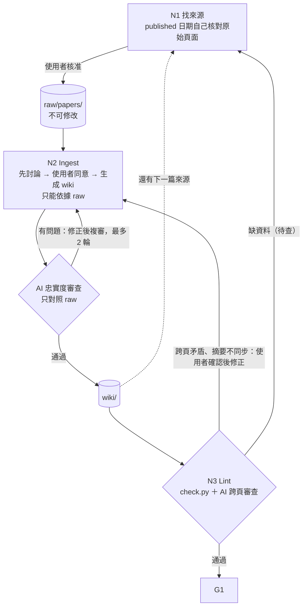
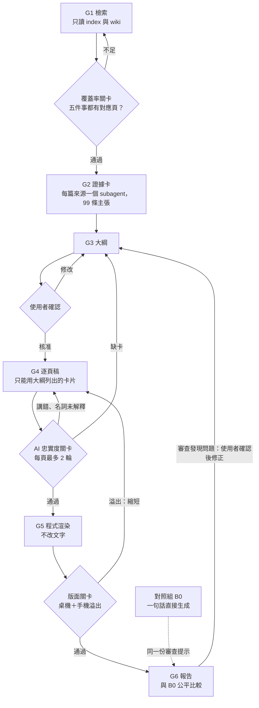

# 朝陽科大 11530621 資通系 第一次自由行怎麼規劃？——以東京為例

## 1. LLM Wiki 主題與簡短介紹

- 主題：第一次自由行怎麼規劃？——以東京為例
- 對象：沒有自助旅行經驗的人
- 內容：依 Karpathy LLM Wiki 架構建立。共 8 篇來源（外交部、JNTO、GO TOKYO、FUN! JAPAN、個人遊記），以「先討論後生成」逐篇 ingest 成 wiki。主題分成五件事：預算、入境、交通、住宿、行程。
- 架構：
  - `raw/papers/`：原文，永不修改
  - `wiki/`：sources／concepts／places 頁，加上 index、overview、log
  - `AGENTS.md`：規則
- 標示規則：每句都要能追到來源。時效資訊標（資訊日期）或（原文無日期），個人遊記標（個人經驗），AI 歸納標（整理者推論），說法矛盾用 ⚠️ 並列。

## 2. LLM Wiki 成果

- GitHub：https://github.com/ella302391352/tokyo-trip-deck （完整專案，也附 zip）
  - 入口：[wiki/index.md](wiki/index.md)、[wiki/overview.md](wiki/overview.md)
  - 變更紀錄：`wiki/log.md`（append-only，每次 ingest／lint 都有紀錄）
  - 每次檢查的完整紀錄：`reviews/`
- 規模：wiki 引用 8 篇來源，有來源頁 8 頁、概念頁 6 頁、地點頁 1 頁。raw 共 9 篇，其中 1 篇是被新版取代的舊入境頁；依規則 raw 不能刪，所以保留但不引用。

## 3. 教學 HTML 簡報連結

- https://ella302391352.github.io/tokyo-trip-deck/ （14 頁）
- 操作：方向鍵、右下按鈕或手機左右滑動
- 原始檔：`slides/deck.html`
- 每頁頁尾都列出依據的 wiki 頁；每個要點後面標有證據卡編號

## 4. Loop / Graph 流程

### Wiki 建置 loop

### 簡報 graph

- 每一關都規定「能看什麼／不能做什麼」。例如 G4 只能看證據卡，G5 不能改文字。
- 退回路線：G4 發現第 12 頁需要的資訊不在大綱的卡片內，所以退回 G3 補卡。

## 5. 一次實際執行的檢查紀錄（G4 → G5）

| 關卡 | 結果 |
|---|---|
| G4 第 1 輪 AI 審查 | 9 頁共 10 個問題：名詞未解釋、漏條件、指代不明、漏資訊、語意改變 |
| G4 第 2 輪 | 8 頁通過；第 09 頁有 3 個輕微問題，都是修正時新帶進來的錯誤，依審查建議原句修改 |
| check.py | 0 錯誤（14 頁皆有出處；數字都能在卡片中找到；各關頁數一致） |
| G5 render_check | 桌機 1280×720 有 0/14 頁溢出；手機 390×844 有 0/14 頁溢出 |
| 對照組 B0 | check.py 17 個錯誤（無機器可驗證的出處、16 頁超出上限）；桌機 4 頁、手機 5 頁溢出 |
| G6 公平比較 | 同一份 AI 審查提示，兩個新 subagent 各審一版（只給該版簡報、wiki、sources.md）。忠實度問題 B0 4 個、graph 3 個；可讀性問題兩版都是 6 個；有問題頁數兩版都是 8 頁 |
| G6 修正 | 依審查結果修 8 頁（補 ⚠️、資訊日期、名詞解釋）；其中 2 頁退回 G3 補卡；修正後 check.py 0 錯誤，桌機與手機 0 頁溢出 |

完整紀錄：`reviews/2026-11-11-G4-G5.md`、`reviews/2026-11-11-B0-baseline.md`、`slides/report.md`

## 6. 反思

### 哪個節點最常出錯？N2（Ingest 生成）

- 第 1 次 Lint（ingest 3 篇後）找到 9 個確定問題，**全部源自 N2**。
  - 分類：找不到來源 4、講反 2、語氣改變 1、個人經驗泛化 2。
  - 數字與日期抄錄的錯誤是 0。
- 錯誤都是「AI 用自己的理解補充、概括，卻沒有標示」，check.py 和 N2 的自我複查都抓不到。
- 錯誤也會擴散。例如一位作者的「熱門景點先買票」被泛化成通則，同時出現在 3 頁。
- 簡報階段也是同樣的模式。G4 補充名詞解釋時，最容易混進卡片以外的內容，第 09 頁就是修正時帶進了新錯誤。

### 如何調整檢查流程（流程有改，共 4 次，皆經使用者同意）

1. **把 AI 審查往前移到 N2**
   - 原本累積 3 篇才在 N3 審，改成每篇 ingest 後立刻審本次改動的頁面。
   - 之後每篇只在源頭攔到 1–2 個問題。
   - 第 2 次 Lint 的逐句忠實度問題降為 0，剩下的 10 項都是跨頁同步問題。
   - 因此 N3 改為專看跨頁問題。
2. **N2 只能依據 raw**
   - 連續兩篇出現同一種錯：N1 搜尋時看過、但沒存進 raw 的資訊（「最後更新」、「著作權屬 JTB」）滲入 wiki。
   - 所以在規則中禁止 N2 使用 N1 的搜尋摘要。
3. **N1 日期必須自己核對原始頁面**
   - 發現一篇來源的日期其實是網站頁尾的全站更新日。
   - N2 的審查只對照 raw，raw 的 metadata 錯了就審不出來，所以要把檢查再往前移到 N1。
   - 處理方式：raw 不改，wiki 中 17 處改為「原文無日期」。
4. **簡報從線性步驟改為 graph**
   - 加入證據卡、逐頁忠實度關卡、程式渲染和版面關卡。
   - 結果：版面溢出從 B0 的 4／5 頁降到 0。
   - 每頁出處可用程式驗證。

### 心得與限制

- 「寫在規則裡」不等於「會被遵守」。第 2 條規則剛訂立，下一篇 ingest 就又違反，靠 N2 的 AI 審查才攔下。所以每條規則都要有對應的檢查。
- 修正本身也會產生新錯誤，所以複審不能省略；每頁上限 2 輪，可以避免無限迴圈。
- 檢查也會漏。手機截圖右側看起來被裁切，但 render_check 回報 0 溢出，推測是無頭瀏覽器最小寬度造成的，需要實機確認。
- G6 公平比較的結果要照實看：
  - Graph 的優勢主要在程式可驗證的項目（出處、頁數、溢出）。
  - 內容忠實度只小幅改善：確定問題 4 → 3。但錯誤的性質不同：B0 是內容被改寫（語氣改強、個人經驗寫成通則），graph 是標示沒帶過來（漏 ⚠️、漏資訊日期）。
- G6 的新發現：graph 版的 3 個忠實度問題，G4 兩輪都沒抓到。
  - 原因：G4 只對照證據卡；G2 抽卡時沒把 wiki 上的 ⚠️、資訊日期帶進卡片，後面的關卡就看不到。
  - 這和 N1 日期錯誤、N2 審查審不出來是同一種模式：每一關只對照上一關的產出，上一關漏掉的，後面都審不出來。
  - 下一步調整：卡片要帶出 wiki 原句的標示，並用 check.py 比對卡片與 wiki 的標示是否一致；最後一關也要回頭對照 wiki，而不是只對照上一關。

## 7. 檔案一覽

| 路徑 | 內容 |
|---|---|
| [AGENTS.md](AGENTS.md) | Wiki 規則（schema） |
| [.agents/workflows/topic-slides.md](.agents/workflows/topic-slides.md) | 簡報 graph 規則：每關能看什麼、不能做什麼、退回路線 |
| [raw/papers/](raw/papers/) | 來源原文（不可修改） |
| [wiki/](wiki/) | LLM Wiki；入口 [index.md](wiki/index.md)、變更紀錄 [log.md](wiki/log.md) |
| [reviews/](reviews/) | 每次 ingest、lint、簡報關卡的檢查紀錄 |
| [slides/](slides/) | 簡報：sources、cards、outline、drafts、[deck.html](slides/deck.html)、[report.md](slides/report.md)；對照組在 baseline/ |
| [tools/](tools/) | check.py（結構檢查）、render_deck.py（渲染）、render_check.py（版面檢查）、fetch_raw.py（抓原文） |
